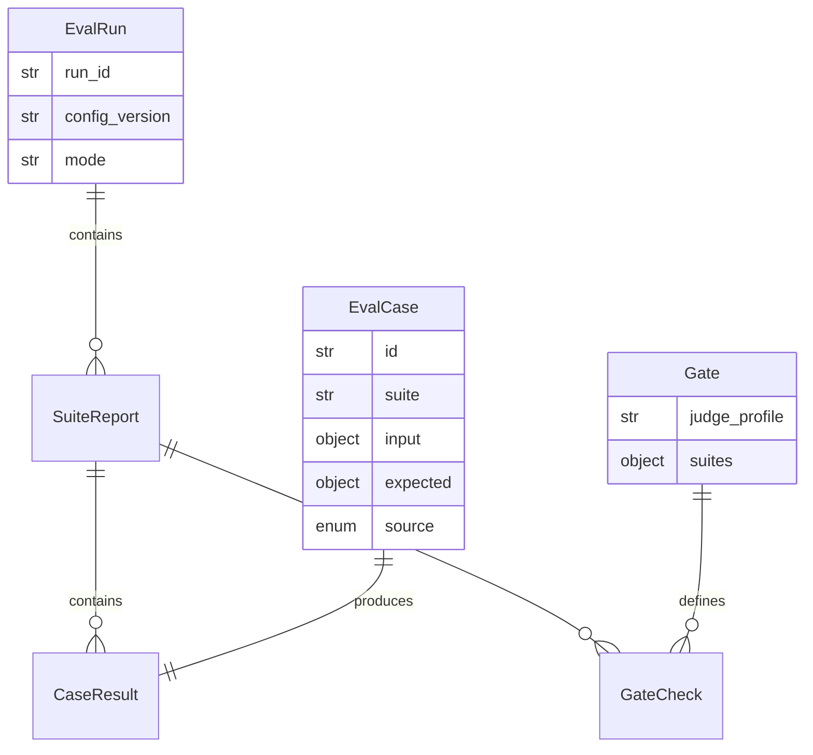

# Data Model: 013-evaluation-framework

**Spec:** [spec.md](spec.md)

Notation: **NEW** = introduced by this spec · **EXISTING** = already in the codebase.

## Entities

### NEW `EvalCase` (`pkpipe.evals.models.EvalCase`)

One line of a `.jsonl` dataset, or one flow case file (`datasets/flows/<id>.json`, `id` defaults to the stem).

| Field | Type | Required | Description |
| --- | --- | --- | --- |
| `id` | str | yes | Unique per dataset |
| `suite` | str | yes | Filled from the dataset when omitted |
| `input` | object | yes | Suite specific: triage `url` / `title` / `note` (or `inputs` verbatim); session node inputs by reference (`read.body`); flow `vault` / `model` / `learning` / `steps`; security `text` |
| `expected` | object | no | Label (`category`, `label`, `owner_score`) or `must_include` / `must_not` / `must_not_match` / `max_words`, or the flow end state |
| `source` | enum | yes (default `synthetic`) | synthetic · override · release · golden |
| `description` | str | no | |

### NEW `EvalRun` / `SuiteReport` / `CaseResult` (reports, `pkpipe.evals.models`)

| Entity | Fields |
| --- | --- |
| `EvalRun` | `run_id` (= `eval.run_id` on every span), `started_at`, `ended_at`, `config_version`, `mode` (live · replay · record · auto), `model`, `judge`, `suites` |
| `SuiteReport` | `suite`, `level` (1-5), `status` (passed · failed · skipped · error), `metrics`, `gate` (list of `GateCheck`), `cases`, `notes`, `reason` |
| `GateCheck` | `metric`, `op` (`>=` / `<=`), `threshold`, `value` (null = metric missing = fail), `passed` |
| `CaseResult` | `case_id`, `passed`, `expected`, `actual`, `error`, `details` |

Written as `eval-<time>-<run>.json` and `.md` to `$PKPIPE_DATA_DIR/evals` (or `--out`).

### NEW `Gate` (`evals.json`, `pkpipe.engine.config_models.EvalsConfig`)

| Field | Type | Description |
| --- | --- | --- |
| `judge_profile` | str | models.json profile of the judge; never a profile an LLM step uses (FR-002) |
| `suites.<suite>.gate.<metric>` | `{min}` or `{max}` | Threshold; only moves upwards (constitution IX) |
| `pairwise.min_score` | float 0-1 | A/B score the new instruction needs (default 0.4) |
| `calibration.max_gap`, `calibration.max_disagreement_rate` | int, float | Judge/owner disagreement limits |

### NEW `GateDecision` (`pkpipe.evals.gate`, returned to the config UI)

`allowed`, `status` (passed · blocked · overridden · unchanged), `affected`, `failures`, `threshold_regressions`,
`pairwise` (per session: outcomes, score, min_score, passed), `override_reason`, `run` (the `EvalRun`).

### NEW Cassette (`evals/cassettes/<suite>.json`)

```json
{"format": 1, "entries": [{"key": "<sha256 of normalised system, user, schema, profile>", "profile": "default",
  "model": "<base_url>|<model>", "request": {"system": "...", "user": "...", "json_schema": {}},
  "response": {} }]}
```

An entry has `response` or `error` (`{"type": "SchemaError", "message": ...}`). Datamarking tokens are replaced by
`TOKEN` in the key and the stored request.

## Diagram



## Storage

- Datasets, rubrics and cassettes: files below `evals/` (public, synthetic) and `<overlay>/evals/` (private).
- Gates: `evals.json` in the config layers; JSON Schema exported by `pkpipe schema`.
- Reports: JSON + Markdown files; no database table.
