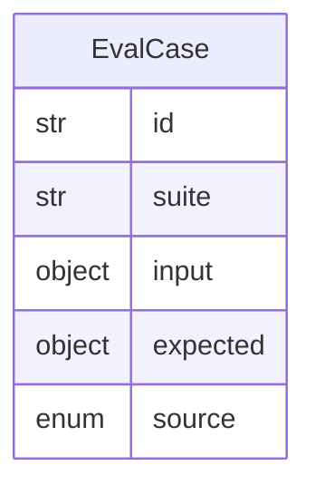

# Data Model: 013-evaluation-framework

**Spec:** [spec.md](spec.md)

Notation: **NEW** = introduced by this spec · **EXISTING** = already in the codebase.

## Entities

### NEW `EvalCase`

| Field | Type | Required | Description |
| --- | --- | --- | --- |
| `id` | str | yes |  |
| `suite` | str | yes |  |
| `input` | object | yes |  |
| `expected` | object | no | Label or must_include / must_not |
| `source` | enum | yes | synthetic · override · release · golden |

## Diagram

## Storage

- Pydantic models in `src/pkpipe`; JSON Schema exported by `pkpipe validate`.
- Persisted rows: SQLite (app DB) or vault files as stated in the spec.
