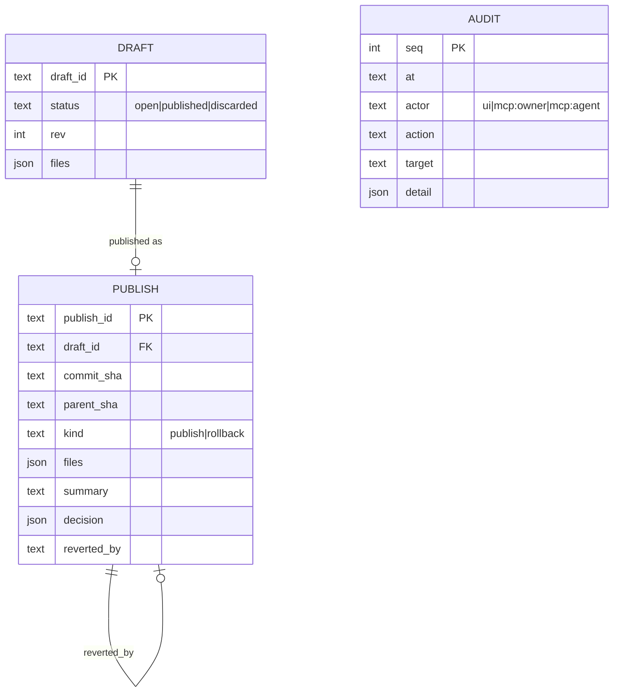

# Data model: 014-config-ui-and-app-mcp

Tables live in the app DB next to `runs` (`pkpipe.adapters.app_store_sqlite`).

## Draft

`files` maps an editable path to `{"content": str | null, "base_hash": str}`. `content: null` deletes the file
from the overlay. `base_hash` is the sha256 of the **overlay** file when the draft first touched it (`absent` for a
new file); publish and validate fail when the file on disk no longer matches. `rev` increments on every save; a
save with an older `rev` fails (two tabs).

Editable paths: `<models|mcp_servers|channels|schedules|categories|security|telemetry|evals>.json`,
`flows/<id>.json`, and `.md` / `.json` / `.txt` below `prompts/`, `instructions/`, `contexts/`, `schemas/`,
`templates/`. Maximum 256 KiB, no NUL bytes.

## Publish

`decision` is the gate report at publish time (`status` passed / overridden / unchanged, `affected`, `failures`,
`override_reason`, `eval_run_id`, `metrics` = measured value, operator and threshold of every gated metric per suite). A rollback row has `kind = rollback` and `decision = {"status": "rollback"}`;
the reverted publish gets `reverted_by`.

## Tokens

`<data dir>/tokens.json` (mode 0600): `{"owner": "...", "agent": "..."}`, generated on first `pkpipe serve`.
`PKPIPE_TOKEN` / `PKPIPE_AGENT_TOKEN` (at least 24 characters, different) override the file.
