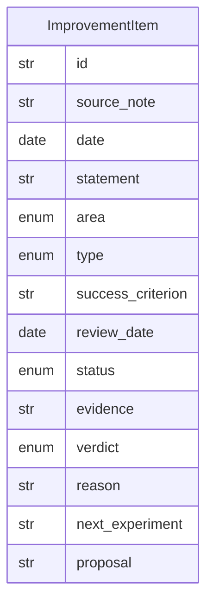

# Data Model: 015-self-improvement-cycle

**Spec:** [spec.md](spec.md)

Notation: **NEW** = introduced by this spec · **EXISTING** = already in the codebase.

## Entities

### NEW `ImprovementItem`

| Field | Type | Required | Description |
| --- | --- | --- | --- |
| `id` | str | yes |  |
| `source_note` | str | yes | Journal note link |
| `date` | date | yes |  |
| `statement` | str | yes |  |
| `area` | enum | yes | personal · learning · work · system |
| `type` | enum | yes | habit · experiment · system-change |
| `success_criterion` | str | no |  |
| `review_date` | date | no |  |
| `status` | enum | yes | proposed · active · reviewing · kept · adjusted · dropped. The pipeline only creates `proposed`; every later value is the owner's edit |
| `evidence` | str | no | Weekly review: dated quotes from the journals, each verbatim (`2026-10-31 (+) "quote" / ...`) |
| `verdict` | enum | no | Weekly review proposal: keep · adjust · drop |
| `reason` | str | no | Weekly review: why, citing the evidence |
| `next_experiment` | str | no | Weekly review: one small next step |
| `proposal` | str | no | Note path of a system-change proposal (kept `system` items) |

## Diagram

## Storage

- Pydantic model `pkpipe.domain.improvement.ImprovementItem`; JSON Schema `improvement-item.schema.json` exported by `pkpipe schema`.
- Persisted as a Markdown table in the vault (managed file `2-Areas/Self-Improvement/Improvement-Backlog.md`, policy key `improvement_file`), columns `status | id | date | area | type | statement | criterion | review | source | evidence | verdict | reason | next | proposal`. Written only through the vault tool `update_improvements`; the owner edits it in Obsidian.
- `id` = first 12 hex of `sha256(source_note + "|" + normalized statement)`, so re-running an extraction never duplicates an item.
- `statement` is the owner's own wording, verbatim from the journal's `## Improvement` section (code-checked); `source_note` is a vault path, shown as a wikilink in the table.
- System-change proposals are notes `2-Areas/Self-Improvement/System-Changes/<id>.md` with `status: awaiting-eval-gate` front matter.
