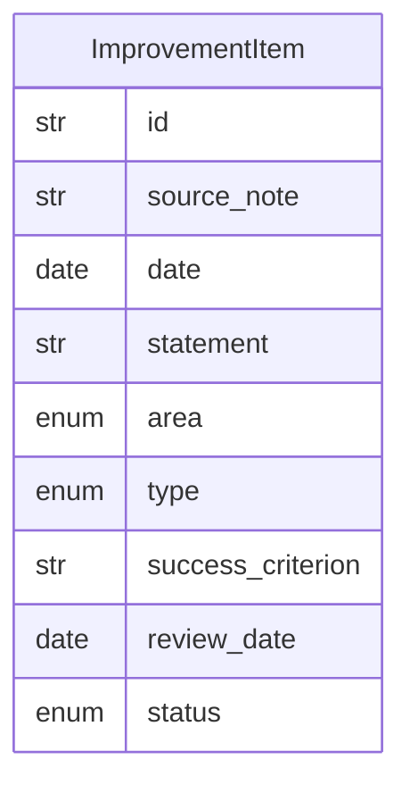

# Data Model: 015-self-improvement-cycle

**Spec:** [spec.md](spec.md)

Notation: **NEW** = introduced by this spec · **EXISTING** = already in the codebase.

## Entities

### NEW `ImprovementItem`

| Field | Type | Required | Description |
| --- | --- | --- | --- |
| `id` | str | yes |  |
| `source_note` | str | yes | Journal note link |
| `date` | date | yes |  |
| `statement` | str | yes |  |
| `area` | enum | yes | personal · learning · work · system |
| `type` | enum | yes | habit · experiment · system-change |
| `success_criterion` | str | no |  |
| `review_date` | date | no |  |
| `status` | enum | yes | proposed · active · reviewing · kept · adjusted · dropped |

## Diagram

## Storage

- Pydantic models in `src/pkpipe`; JSON Schema exported by `pkpipe validate`.
- Persisted rows: SQLite (app DB) or vault files as stated in the spec.
