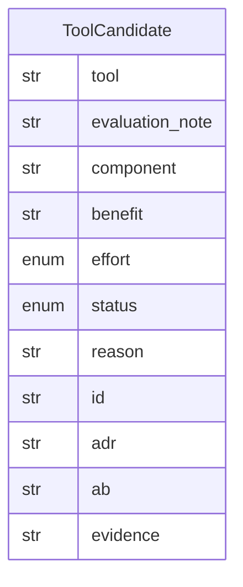

# Data Model: 016-system-tool-candidates

**Spec:** [spec.md](spec.md)

Notation: **NEW** = introduced by this spec · **EXISTING** = already in the codebase.

## Entities

### NEW `ToolCandidate`

| Field | Type | Required | Description |
| --- | --- | --- | --- |
| `tool` | str | yes |  |
| `evaluation_note` | str | yes | Link |
| `component` | str | yes | C4 component name |
| `benefit` | str | yes |  |
| `effort` | enum | yes | S · M · L |
| `status` | enum | yes | candidate · investigating · trial · adopted · rejected |
| `reason` | str | no | Required when rejected |
| `id` | str | yes | Identity of the tool (lower-case alphanumerics of its name): `Vector-Lite` and `vector lite` are one candidate |
| `adr` | str | no | File name of the ADR in `docs/decisions/`; required for adopted |
| `ab` | str | no | Summary of the A/B report (`better (...)`); required for adopted |
| `evidence` | str | no | New evidence that reopened a rejected candidate |

## Diagram

## Storage

- Pydantic models in `src/pkpipe`; JSON Schema exported by `pkpipe validate`.
- Persisted rows: the vault table `2-Areas/System/System-Tool-Candidates.md` (`VaultPolicy.tool_candidates_file`), edited in Obsidian by the owner and written by the pipeline through `update_tool_candidates` (add only). JSON Schema `tool-candidate.schema.json`.
- `AbReport` (JSON file written by `pkpipe candidates ab`): `tool`, `verdict` (better | equal | worse | inconclusive), `gate_green`, `baseline_version`, `candidate_version`, `suites`, `metrics` (suite, metric, direction, baseline, candidate, verdict), `pairwise` (session, score, outcomes), `reasons`, `failures`, `tolerance`, `margin`.
