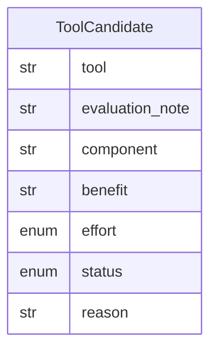

# Data Model: 016-system-tool-candidates

**Spec:** [spec.md](spec.md)

Notation: **NEW** = introduced by this spec · **EXISTING** = already in the codebase.

## Entities

### NEW `ToolCandidate`

| Field | Type | Required | Description |
| --- | --- | --- | --- |
| `tool` | str | yes |  |
| `evaluation_note` | str | yes | Link |
| `component` | str | yes | C4 component name |
| `benefit` | str | yes |  |
| `effort` | enum | yes | S · M · L |
| `status` | enum | yes | candidate · investigating · trial · adopted · rejected |
| `reason` | str | no | Required when rejected |

## Diagram

## Storage

- Pydantic models in `src/pkpipe`; JSON Schema exported by `pkpipe validate`.
- Persisted rows: SQLite (app DB) or vault files as stated in the spec.
