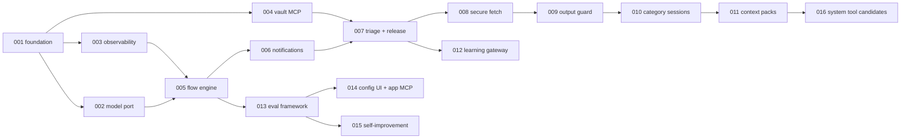

# Specs – pkpipe

Spec-kit based specifications. Constitution: [`.specify/memory/constitution.md`](../.specify/memory/constitution.md),
templates: [`.specify/templates/`](../.specify/templates/), conventions: [`.claude/instructions/spec-conventions.md`](../.claude/instructions/spec-conventions.md).
Each spec has `spec.md`, `plan.md`, `tasks.md`; `research.md` and `data-model.md` where a technology choice or a data structure is involved.

| Spec | Title | Status | Companions |
| --- | --- | --- | --- |
| [001-foundation-and-docs](001-foundation-and-docs/spec.md) | Repository foundation and documentation site | Completed |  |
| [002-model-port](002-model-port/spec.md) | ModelPort and OpenAI-compatible model adapter | Completed | research · data-model |
| [003-observability](003-observability/spec.md) | OpenTelemetry tracing and metrics | Completed | research |
| [004-obsidian-vault-mcp](004-obsidian-vault-mcp/spec.md) | obsidian-vault MCP server | Completed | research · data-model |
| [005-flow-engine](005-flow-engine/spec.md) | Flow engine: compiler, step executors, run service, scheduler | Completed | research · data-model |
| [006-notifications](006-notifications/spec.md) | Notification port and channels | Completed |  |
| [007-triage-and-release](007-triage-and-release/spec.md) | Daily triage and morning release | Active |  |
| [008-secure-fetch](008-secure-fetch/spec.md) | Secure fetch | Completed | research · data-model |
| [009-output-guard-and-quarantine](009-output-guard-and-quarantine/spec.md) | Output guard and quarantine | Completed | research · data-model |
| [010-category-sessions](010-category-sessions/spec.md) | Category session plans and Process Other Resource | Completed | data-model |
| [011-context-packs](011-context-packs/spec.md) | Context packs and weekly refresh | Completed | data-model |
| [012-learning-gateway](012-learning-gateway/spec.md) | learning-gateway MCP and Process Learning Material | Active | research · data-model · contracts |
| [013-evaluation-framework](013-evaluation-framework/spec.md) | Evaluation framework and gates | Completed | research · data-model |
| [014-config-ui-and-app-mcp](014-config-ui-and-app-mcp/spec.md) | Config UI and app MCP server | Completed | research · data-model · contracts |
| [015-self-improvement-cycle](015-self-improvement-cycle/spec.md) | Self-improvement cycle (overlay) | Completed | data-model |
| [016-system-tool-candidates](016-system-tool-candidates/spec.md) | System tool candidates | Draft | data-model |

## Implementation order

Milestones: **F0** = 001–004 · **F1** = 005–007 + 013 (triage live) · **F2** = 008–012 · **F3** = 014–016 · **F4** = public release.
